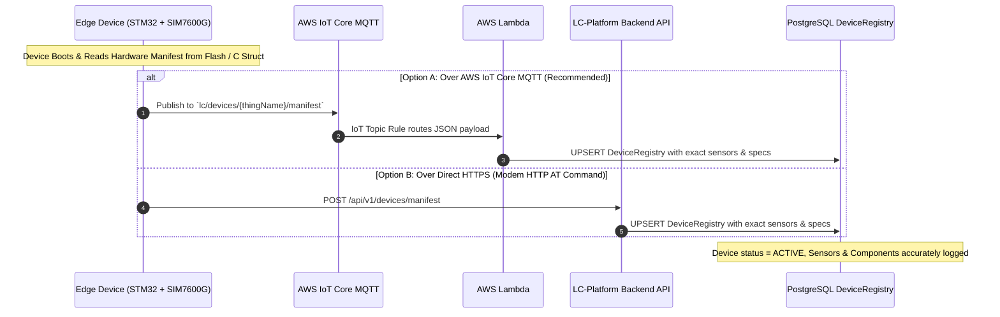

# LC-Platform — Firmware & Hardware Manifest Specification
## Device Registry Synchronization Guide for Hardware & Firmware Engineers

> [!IMPORTANT]
> **Core Principle**: The cloud server and database **do not hardcode or assume any sensor or component attributes**. All hardware specifications, sensors, calibration constants, and component inventories must be defined directly in the **device firmware** and transmitted to the LC-Platform during device boot / commissioning.

---

## 1. Architectural Overview



---

## 2. Standard Device Configuration JSON Manifest

This is the exact JSON structure that the firmware generates and transmits to the cloud:

```json
{
  "thingName": "LC-0001-01",
  "serialNumber": "LC-0001-01",
  "deviceType": "MASTER",
  "status": "ACTIVE",

  "hardware": {
    "version": "rev2.1",
    "mcu": "STM32F401RET6 ARM Cortex-M4 @ 84MHz",
    "modem": "SIM7600G-H LTE CAT-4",
    "imei": "864205041234567",
    "macAddress": "A4:CF:12:89:BC:44"
  },

  "firmware": {
    "version": "v2.1.4",
    "buildDate": "2024-10-20T10:00:00Z",
    "gitCommit": "a3f8c9b",
    "bootloader": "v1.0.2",
    "checksum": "0x9E4B1F"
  },

  "manufacturing": {
    "manufacturer": "Mirtha / LC-Platform",
    "modelNumber": "LC-GATE-MASTER-V2",
    "batchNumber": "BATCH-2024-Q3",
    "dateOfMfg": "2024-05-15"
  },

  "runtimeConfig": {
    "telemetryIntervalSec": 10,
    "heartbeatIntervalSec": 60,
    "batteryLowThresholdV": 11.8,
    "solarCutinVoltageV": 13.2
  },

  "sensors": [
    {
      "id": "solar_voltage",
      "name": "Solar Panel Voltage Monitor",
      "type": "VOLTAGE_ADC",
      "interface": "ADC1_IN0",
      "pin": "PA0",
      "unit": "V",
      "range": "0-30V",
      "calFactor": 11.0
    },
    {
      "id": "battery_current",
      "name": "LiFePO4 Shunt Current Monitor",
      "type": "CURRENT_SHUNT",
      "interface": "I2C1",
      "pin": "0x40",
      "unit": "A",
      "range": "-30A to +30A",
      "calFactor": 1.0
    },
    {
      "id": "boom_angle",
      "name": "Boom Barrier Inclinometer",
      "type": "INCLINOMETER",
      "interface": "I2C1",
      "pin": "0x68",
      "unit": "deg",
      "range": "0-90 deg",
      "calFactor": 1.0
    },
    {
      "id": "train_radar",
      "name": "Train Approach Doppler Radar",
      "type": "RADAR",
      "interface": "USART2",
      "pin": "PA2/PA3",
      "unit": "km/h",
      "range": "0-160 km/h",
      "calFactor": 1.0
    }
  ],

  "components": [
    {
      "name": "Main Controller MCU",
      "model": "STM32F401 Blackpill",
      "spec": "ARM Cortex-M4 84MHz, 256KB Flash, 64KB RAM",
      "vendor": "STMicroelectronics"
    },
    {
      "name": "Cellular LTE Modem",
      "model": "SIM7600G-H",
      "spec": "LTE Cat-4 Global Bands + GNSS GPS/GLONASS",
      "vendor": "SIMCom"
    },
    {
      "name": "Solar MPPT Controller",
      "model": "MPPT 12V 10A Intelligent",
      "spec": "Synchronous Buck MPPT, 98% efficiency",
      "vendor": "OEM"
    },
    {
      "name": "Deep-Cycle Battery Pack",
      "model": "LiFePO4 12.8V 24Ah",
      "spec": "4S LiFePO4 with Integrated Active BMS",
      "vendor": "OEM"
    }
  ]
}
```

---

## 3. Field Definitions & Schema Reference

| Field | Type | Description |
|---|---|---|
| `thingName` | String | **Required**. Matches the AWS IoT Thing Name (e.g. `LC-0001-01`). |
| `serialNumber` | String | Device hardware serial number. Used to auto-link with Gate and Cluster tables. |
| `deviceType` | String | `MASTER` (main controller) or `SLAVE` (barrier unit, child node). |
| `hardware.version` | String | Hardware PCB revision (e.g. `rev2.1`). |
| `hardware.mcu` | String | Microcontroller part number. |
| `hardware.modem` | String | Cellular modem part number. |
| `hardware.imei` | String | 15-digit modem IMEI read from modem (`AT+GSN`). |
| `firmware.version` | String | Active firmware version string (e.g. `v2.1.4`). |
| `manufacturing.dateOfMfg` | String | Date of manufacturing in `YYYY-MM-DD` format. |
| `sensors` | Array | Array of internal sensors physically connected to this unit. |
| `sensors[].id` | String | Short identifier for telemetry mapping. |
| `sensors[].name` | String | Human-readable name. |
| `sensors[].type` | String | `VOLTAGE_ADC`, `CURRENT_SHUNT`, `INCLINOMETER`, `RADAR`, `TEMP`, `PROXIMITY`. |
| `sensors[].interface` | String | Pin or hardware bus (`ADC1_IN0`, `I2C1`, `USART2`, `SPI1`). |
| `sensors[].pin` | String | Physical pin (`PA0`, `PB12`) or I2C address (`0x40`, `0x68`). |
| `sensors[].calFactor` | Float | Calibration multiplier or voltage divider ratio. |
| `components` | Array | List of hardware sub-modules and major onboard components. |
| `runtimeConfig` | Object | Runtime operating thresholds and report intervals. |

---

## 4. Transmission Methods from Firmware

### Method 1: AWS IoT MQTT Topic (Option A - Recommended & Standard)

In this approach, the physical edge hardware (STM32 MCU + SIM7600G modem) establishes an encrypted TLS MQTT connection with your AWS IoT Core endpoint and publishes the manifest directly.

#### 1. Target MQTT Topic
```text
lc/devices/<thingName>/manifest
```
*(Example: `lc/devices/LC-0001-01/manifest`)*

#### 2. AWS IoT Topic Rule Configuration
Create a dedicated Topic Rule in AWS IoT Core Console (or run `setup-iot-rule.bat`):
- **Rule Name**: `lc_platform_device_manifest_rule`
- **SQL Statement**:
  ```sql
  SELECT *, topic(3) as topicThingName FROM 'lc/devices/+/manifest'
  ```
- **Rule Action**: Invoke Lambda function `lc-platform-device-registration`
- **Error Action** (Optional): CloudWatch Logs

#### 3. SIM7600G AT Command Sequence (MQTT over TLS on Port 8883)
The firmware team communicates with the SIM7600G modem via UART using standard cellular MQTT AT commands:

```text
// 1. Initialize cellular PDP context
AT+CGATT=1
AT+CGACT=1,1

// 2. Configure SSL / TLS Certificates on SIM7600 (Root CA, Device Cert, Private Key)
AT+CCERTDOWN="ca.pem",<ca_size>
<SEND_AWS_ROOT_CA_PEM>
AT+CCERTDOWN="client.pem",<cert_size>
<SEND_DEVICE_CERT_PEM>
AT+CCERTDOWN="key.pem",<key_size>
<SEND_PRIVATE_KEY_PEM>

// 3. Configure SSL profile 0 for AWS IoT (Port 8883)
AT+CSSLCFG="sslversion",0,4
AT+CSSLCFG="authmode",0,2
AT+CSSLCFG="cacert",0,"ca.pem"
AT+CSSLCFG="clientcert",0,"client.pem"
AT+CSSLCFG="clientkey",0,"key.pem"

// 4. Start MQTT service & acquire client session
AT+CMQTTSTART
AT+CMQTTACCQ=0,"LC-0001-01",1

// 5. Connect to AWS IoT Core Endpoint (replace with your account's iot endpoint)
AT+CMQTTSSLCFG=0,0
AT+CMQTTCONNECT=0,"tcp://a2xxxxxxxxxxxx-ats.iot.ap-south-1.amazonaws.com:8883",60,1

// 6. Set Topic: lc/devices/LC-0001-01/manifest
AT+CMQTTTOPIC=0,31
lc/devices/LC-0001-01/manifest

// 7. Set JSON Payload (payload length in bytes)
AT+CMQTTPAYLOAD=0,1650
<SEND_DEVICE_MANIFEST_JSON_STRING>

// 8. Publish Message with QoS 1
AT+CMQTTPUB=0,1,60

// Expected Response from modem:
// +CMQTTPUB: 0,0  (Success! Delivered to AWS IoT Core)
```

#### 4. Cloud Flow on Message Receipt
1. AWS IoT Core receives the message on `lc/devices/LC-0001-01/manifest`.
2. Rule `lc_platform_device_manifest_rule` extracts the JSON body and thingName (`topic(3)`).
3. Rule invokes `lc-platform-device-registration` Lambda.
4. Lambda checks associations (e.g. LC-0001 gate, MasterUnit) and upserts `DeviceRegistry` table in RDS.
5. Web dashboard immediately reflects the real sensors, components, firmware revision, and hardware profile.

### Method 2: Direct HTTPS POST (via SIM7600G AT Commands)

Firmware can send the JSON directly via modem HTTP commands:
- **URL**: `https://<YOUR_BACKEND_URL>/api/v1/devices/manifest`
- **Method**: `POST`
- **Header**: `Content-Type: application/json`

SIM7600 AT Sequence:
```text
AT+HTTPINIT
AT+HTTPPARA="URL","https://api.lcplatform.com/api/v1/devices/manifest"
AT+HTTPPARA="CONTENT","application/json"
AT+HTTPDATA=1850,10000
<SEND JSON STRING HERE>
AT+HTTPACTION=1
AT+HTTPTERM
```

---

## 5. Firmware C Code Header & Implementation Files

Ready-to-use C source files have been placed in your repository:
- **Header File**: [`firmware/device_config.h`](file:///c:/Users/PC/Desktop/Internship/LC-Gate/firmware/device_config.h)
- **C Source File**: [`firmware/device_manifest.c`](file:///c:/Users/PC/Desktop/Internship/LC-Gate/firmware/device_manifest.c)
